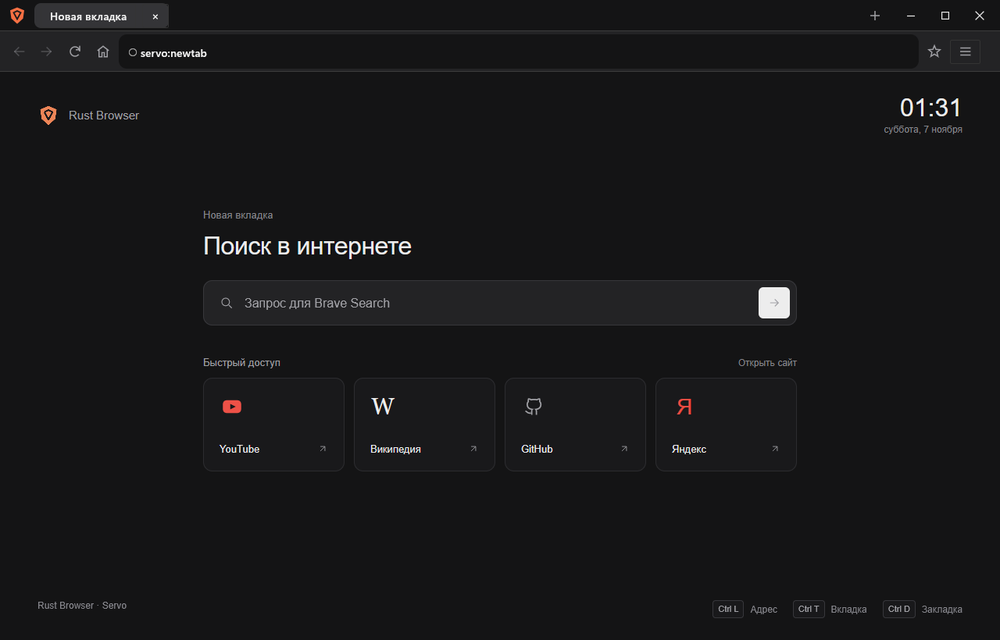

<p align="center"></p>
<h1 align="center">Rust Browser</h1>
<p align="center">A native Rust browser built on Servo</p>



Rust Browser is an experimental Windows desktop browser with familiar tabbed
navigation, a local profile, adaptive connection routing and a native password
manager. The interface uses quiet graphite surfaces, a configurable accent and
optional translucent menus. This repository remains private during development.

## Features

- Integrated Servo engine, tabs, navigation, bookmarks, history and session restoration
- Dark/light chrome, accent colors, compact navigation and optional glass effects
- Direct, automatic and proxy-only routing, with domain exceptions
- Local subscription import: VLESS, VMess, Trojan, Shadowsocks and XHTTP via Xray
- DPAPI-encrypted password vault in a separate native window
- CSV password import/export and read-only Brave bookmark/history import
- Search open tabs with Ctrl+Shift+A and reopen a closed tab with Ctrl+Shift+T
- Connection details from actual main-document TLS evidence, with explicit HTTP/error states
- Event-driven rendering: delayed UI timers do not cause a continuous repaint loop

## Run

For a locally packaged build, run `Start-Browser.cmd`. Keep the application bundle's
`resources` and `runtime` folders beside `RustBrowser.exe`. Downloads of network
cores are separate from source control and verified against pinned SHA-256 hashes.

Your profile is stored in `%LOCALAPPDATA%\RustBrowser`. Profile data, authentication
material and subscription keys are never part of this repository.

## Build on Windows

Requirements: Rust stable, Visual Studio C++ tools with Windows SDK, and Python
3.11 or newer. Start PowerShell in the repository and use your Python executable:

```powershell
.\Setup-BuildTools.ps1 -PythonPath C:\Path\To\python.exe
.\Download-NetworkCores.ps1
.\Build-Browser.ps1 -PythonPath C:\Path\To\python.exe
.\Package-Browser.ps1
.\Start-Browser.cmd
```

Build caches use `.build` by default. `RUST_BROWSER_WORK` overrides that directory.
The GitHub repository contains all browser modifications as an overlay. On the
first build, Initialize-ServoSource.ps1 downloads Servo v0.7.0 at the pinned
revision and applies BROWSER-OVERLAY.json inside the generated build workspace.
Upstream code remains available from its official repository; third-party
notices are retained. This avoids vendoring the large upstream WPT corpus.
The Codex development checkout also recognizes its existing adjacent `work` folder.
For an optimized build pass `-Release` to both build and packaging scripts.

## Verify

```powershell
.\Build-Browser.ps1 -CoreTests -PythonPath C:\Path\To\python.exe
.\Build-Browser.ps1 -UiTests -PythonPath C:\Path\To\python.exe
.\Build-Browser.ps1 -NetworkTests -PythonPath C:\Path\To\python.exe
```

CI checks profiles, subscriptions, DPAPI, CSV behavior and UI scheduling. Full desktop
builds and site compatibility require separate validation; see [BUILD-REPORT.md](BUILD-REPORT.md).

## Status

This is a development browser, not a Chromium-compatible release. Chrome extensions,
Brave Shields, DRM and the media backend are not implemented in this build. A live
subscription must be imported locally before restricted sites can use it. Arbitrary
websites and unlimited tabs cannot be guaranteed to stay below 500 MB.

The supported Brave importer transfers bookmarks and up to 10,000 history
entries. Active authenticated sessions/cookies are not imported. Passwords can be
transferred using the native manager's explicit CSV workflow.

Close Rust Browser before running `app/RustBrowser.exe --import-brave` for the
profile-only import. It creates a local profile backup and never opens the vault.

## Project

- [Roadmap](ROADMAP.md)
- [Contributing](CONTRIBUTING-BROWSER.md)
- [Russian usage guide](README-BROWSER.md)
- [Design report](design/UNSLOP-REPORT.md)
- [Private repository status](PRIVATE-REPOSITORY.md)

## Upstream and credits

Built from [Servo](https://github.com/servo/servo) v0.7.0, baseline
`aac43a3f31a259f04a574f5ec4e959c943ad7cc7`. Upstream source notices and
[MPL-2.0](LICENSE) are preserved. Original Servo documentation is retained in
[docs/UPSTREAM-SERVO-README.md](docs/UPSTREAM-SERVO-README.md).

Design workflow: [unslop](https://github.com/heydamir/unslop) by **Damir Sokolovsky
(@heydamir)**, CC BY 4.0. Line icons follow Lucide; attribution is in `design`.
sing-box and Xray run as separate processes; their sources, licenses and hashes
are documented in `runtime/THIRD-PARTY.txt`.
